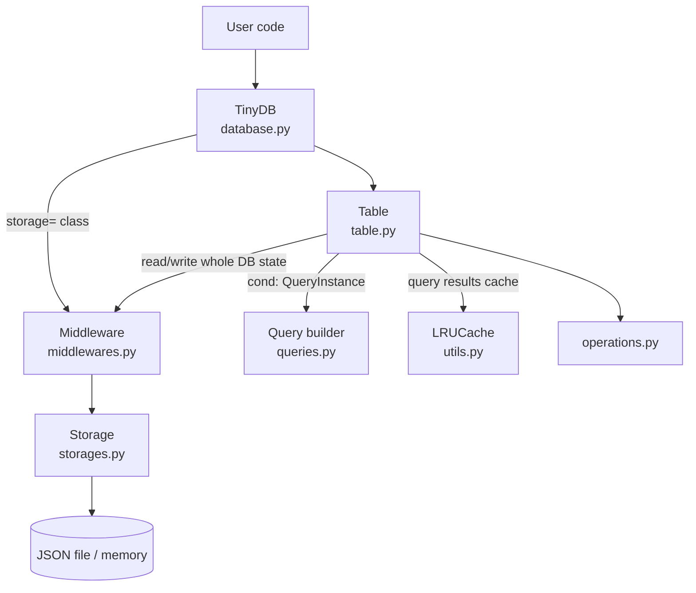

# TinyDB Architecture

TinyDB is a small, pure-Python, document-oriented database. A database is a
single storage target holding a dict of tables; each table maps integer
document IDs to documents (plain dicts). This document describes the main
components, three key design decisions, and the rules to respect when
changing the code.

## 1. Component overview

- **TinyDB** (`tinydb/database.py`) - the entry point. It creates the
  storage instance (from the `storage=` class argument, defaulting to
  `JSONStorage`), keeps a registry of opened `Table` instances, manages
  table creation/deletion, and forwards unknown attribute lookups to the
  default table so `db.insert(...)` works directly.
- **Table** (`tinydb/table.py`) - all CRUD and query logic for one table.
  It owns the query cache (an `LRUCache`), assigns document IDs, and on
  every mutation rewrites the whole database state through the storage
  and then clears the query cache.
- **Query / QueryInstance** (`tinydb/queries.py`) - the query builder.
  Attribute/item access on `Query` builds a field path; comparison
  operators and methods like `matches` or `one_of` produce a
  `QueryInstance`, a callable that tests one document and carries a
  stable hash so it can key the query cache. `&`, `|` and `~` combine
  instances into new ones.
- **Storage** (`tinydb/storages.py`) - the persistence layer. `Storage`
  is an abstract base class with `read()` / `write()`; `JSONStorage`
  keeps the database as a JSON file, `MemoryStorage` in RAM. `read()`
  returns `None` for an empty database.
- **Middleware** (`tinydb/middlewares.py`) - wraps a storage class to
  intercept reads/writes. `CachingMiddleware` keeps the whole database
  state in memory and only writes through every `WRITE_CACHE_SIZE`
  (1000) writes or on `close()`.
- **Operations** (`tinydb/operations.py`) - small transform factories
  (`delete`, `add`, `subtract`, `set`, `increment`) passed to
  `Table.update`.
- **Utils** (`tinydb/utils.py`) - `LRUCache`, `freeze` (makes values
  hashable for query hashes) and typing helpers.

Call flow for a search: `db.search(cond)` (forwarded to the default
`Table`) checks the table's query cache by the query's hash; on a miss it
reads the whole table state through the middleware/storage stack, tests
each document with `cond(doc)`, caches the matching `Document` list and
returns a copy. Writes go the other way: `Table` builds the new full
state and pushes it down through the middleware to the storage, then
invalidates the query cache.

## 2. Architecture decision records

### ADR 1: Storages serialize the whole database state - Status: Verified

- **Context:** TinyDB needs a persistence abstraction simple enough for
  users to implement themselves (YAML, compressed formats, remote
  stores, ...).
- **Decision:** The `Storage` protocol is exactly two methods:
  `read()` returns the entire database as a dict of tables
  (`{table: {doc_id: document}}`) or `None` when empty, and
  `write(data)` persists that entire dict
  (`tinydb/storages.py`, `Storage.read`/`Storage.write` docstrings).
- **Alternatives:** per-document or per-table storage APIs (richer, but
  far more to implement and to keep consistent); an append-only log
  (fast writes, complex reads/compaction).
- **Consequences:** implementing a storage is trivial, but every write
  re-serializes the whole database (write amplification), which is why
  `CachingMiddleware` exists. Storages must accept extra `**kwargs`
  gracefully because `TinyDB(...)` forwards its own constructor
  arguments to the storage constructor.

### ADR 2: Query cache keyed by a stable query hash - Status: Verified

- **Context:** `Table.search` re-evaluates the condition against every
  document; repeated identical searches were wasted work.
- **Decision:** Every `QueryInstance` carries a `hashval` describing the
  operation, path and arguments (made hashable with `freeze`); `Table`
  caches search results in an `LRUCache` keyed by the query object and
  clears the cache on every mutation (`tinydb/table.py`,
  `tinydb/queries.py`). Queries that cannot produce a stable hash (for
  example after `.map(fn)`) report `is_cacheable() == False` and skip
  the cache.
- **Alternatives:** no caching; caching keyed by `repr` of the query
  (fragile); result invalidation per document instead of clearing the
  whole cache.
- **Consequences:** anything that changes what a query matches must
  change its hash - commit `e83efcd` had to add regex flags to the
  `matches`/`search` hashval (issue #637/#640) or two different queries
  shared one cache entry; mutation methods must always clear the cache.

### ADR 3: Middlewares wrap storages through a callable-instance pattern - Status: Verified

- **Context:** cross-cutting storage behaviour (caching) should compose
  with any storage without changing `TinyDB` or the storage classes.
- **Decision:** a middleware is constructed with the *real* storage
  class (`CachingMiddleware(JSONStorage)`) and passed to
  `TinyDB(storage=...)` as an already-created instance; `TinyDB` calls
  `storage(*args, **kwargs)`, which invokes `Middleware.__call__`, and
  only then is the inner storage instantiated. Unknown attributes are
  forwarded to the wrapped storage (`tinydb/middlewares.py`).
- **Alternatives:** inheritance-based variants per storage; hooks inside
  `TinyDB` itself.
- **Consequences:** middlewares nest naturally
  (`MiddlewareA(MiddlewareB(Storage))`), but every middleware must call
  `super().__init__(storage_cls)` and forward constructor args, or the
  chain silently mis-initializes; caching defers durability until flush,
  so `close()` must flush (and use-after-close is rejected with
  `ValueError`).

## 3. Constraints (do not break these when changing the code)

1. **New storages must subclass `Storage`** and implement `read()` /
   `write()`; `read()` must return `None` (not `{}`) for an empty
   database. Seen in `tinydb/storages.py` (`class Storage(ABC)` with
   `@abstractmethod` methods, `JSONStorage.read`).
2. **A middleware's `__init__` must call `super().__init__(storage_cls)`**
   and its `__call__` must forward `*args, **kwargs` to the wrapped
   class, otherwise the storage chain is never built. Seen in
   `tinydb/middlewares.py` (`Middleware.__init__` / `__call__`).
3. **Query objects must keep stable hashes:** a query's `hashval` must
   capture everything that affects its result; if that is impossible,
   the query must be uncacheable (`is_cacheable()` False). Seen in
   `tinydb/queries.py` (`QueryInstance`, `Query.test` docstring warning,
   `Query.map`).
4. **`Table` mutation methods must clear the query cache** after writing
   new state, or later searches serve stale results. Seen in
   `tinydb/table.py` (`Table._update_table` calls `self.clear_cache()`).
5. **Layering: `queries.py` must not import `table.py` or
   `database.py`** - the query builder is the lowest layer and stays
   free of storage/table dependencies (it imports only from
   `tinydb/utils.py`). Seen in `tinydb/queries.py` import block.
