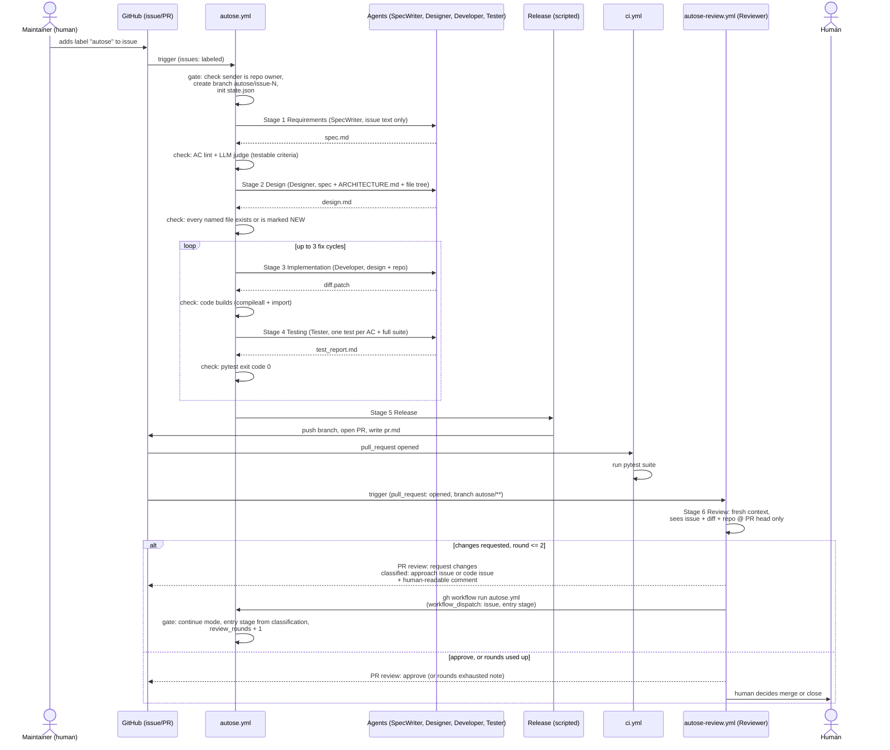

# Sequence view: one run from label to review

This is the path of one issue through the system. The concrete instance of
this view, with links to the real Actions runs, PRs and reviews, is in
`results/runs.md`.

## Reading the loop

- Tests failing inside stage 4 loop back to implementation **within the same
  job** (cheap, no new run) up to 3 cycles; after that the run stops and
  `test_report.md` says why.
- Reviewer feedback loops back **across workflows**: the review lives in a
  different workflow with different (read-only) permissions, so it cannot
  push state; it dispatches a continuation run of the main workflow instead
  (workflow_dispatch is exempt from GitHub's recursion guard; a bot's PR
  comment would not re-trigger anything) and leaves a comment for humans.
  An approach issue re-enters at design; a code issue re-enters at
  implementation; at most 2 review rounds, then the human decides.
- Every stage boundary is a checkpoint: artifacts and `state.json` are
  committed to the branch, so a restarted run resumes instead of repeating
  work (and repeating cost).
